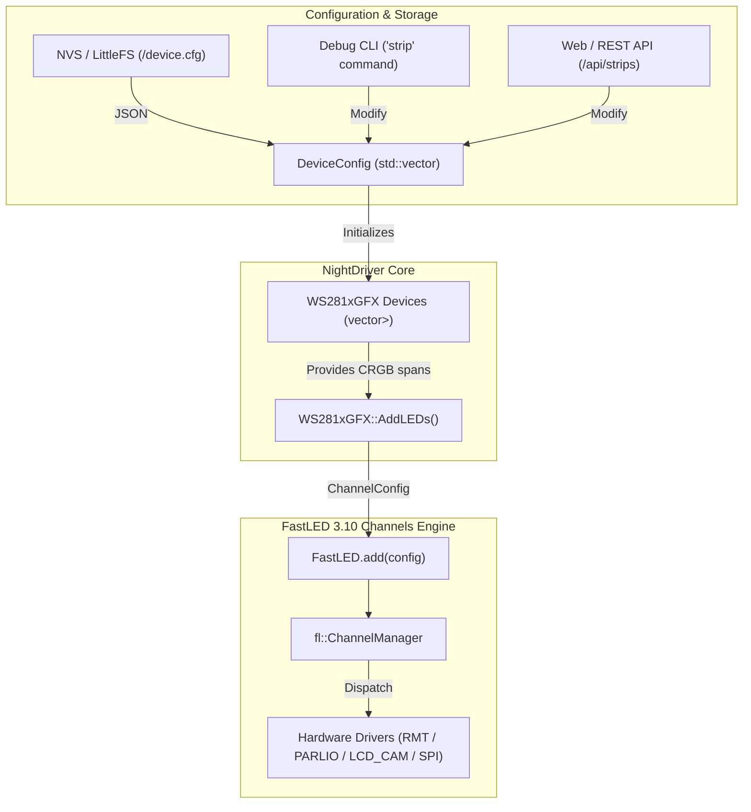

# FastLED Channels API Implementation Plan: Dynamic Strip Management

**Date:** November 2026
**Branch:** `channels`
**Toolchain:** PlatformIO / Arduino 4.0 / ESP-IDF 6.1 (GCC 15, C++26)
**Status:** In Progress / Phases 1–5 Delivered (Verified on Physical Hardware)

---

## 1. Executive Summary & Goals

The goal of the `channels` branch is to decouple NightDriver's LED hardware layer from compile-time templates, transitioning `WS281xGFX::AddLEDs()` to FastLED 3.10's non-template **Channels API** (`FastLED.add(fl::ChannelConfig)`).

This unlocks:
1. **Runtime Pin & Length Configuration:** Change data pins, pixel counts, and color orders via CLI, Web UI, and JSON configs without recompiling.
2. **Arbitrary Strip Topologies:** Break the historical 8-channel ceiling; support $N$ variable-length strips driven concurrently.
3. **Build Matrix Deconstruction:** Eliminate `-DLED_PIN0`, `-DCOLOR_ORDER`, and `-DNUM_CHANNELS` from `globals.h`, allowing `ccache` and PlatformIO to share object files across dozens of strip targets.

---

## 2. Architecture Overview



---

## 3. Data Structures & Schema

### 3.1 `StripConfig` Struct & The Unified Pin Abstraction
In `include/deviceconfig.h`:

```cpp
enum class ChipsetType : uint8_t {
    WS2812B = 0,   // 800kHz clockless (WS2812, WS2812B, WS2813, SK6812)
    WS2811,        // 400kHz / 800kHz
    WS2815,        // 12V clockless
    APA102,        // 2-wire SPI (Data + Clock)
    SK9822,        // 2-wire SPI (Data + Clock)
};

struct StripConfig {
    int dataPin = -1;
    int clockPin = -1;                // For SPI chipsets (APA102/SK9822), -1 for clockless
    uint16_t length = 60;
    EOrder colorOrder = EOrder::GRB;
    ChipsetType chipset = ChipsetType::WS2812B;
    bool enabled = true;
};
```

> **Design Note: Pin Abstraction & System-Wide Peripheral Scope**
> When modeling GPIO pin types (with observers for change detection), keep other dynamically configurable peripherals in view:
> - **IR Remote Receiver Pin** (`IR_REMOTE_PIN`)
> - **I2S Audio Input Pins** (`I2S_BCLK_PIN`, `I2S_WS_PIN`, `I2S_DATA_IN_PIN`)
> - **Buttons & Encoders** (`TOGGLE_BUTTON_0`, etc.)
>
> A unified pin assignment model prevents hardware collisions (e.g., ensuring a strip cannot claim a pin already assigned to I2S or IR).
>
> **Scope Boundary:** HUB75 matrices require 14–16 tightly coupled DMA pins and remain compile-time/board-specific for now. Dynamic reconfiguration applies to LED strips, IR remote, and I2S audio.

### 3.2 JSON Representation in `device.cfg`
```json
{
  "strips": [
    {
      "pin": 14,
      "clock": -1,
      "length": 64,
      "order": "GRB",
      "chipset": "WS2812B",
      "enabled": true
    }
  ]
}
```

### 3.3 Default Fallback & The `-DLED_PINS` Array Notation
To support boards with $\ge 8$ channels (e.g., LightCrafter-16, 16-channel WS2812 boards) cleanly without defining 16 separate macros, we support modern array notation in `platformio.ini`:

```ini
; Single-strip board
build_flags = -DLED_PINS=14

; Multi-strip board (e.g., LightCrafter-16)
build_flags = -DLED_PINS=16,17,18,19,21,22,23,25,26,27,32,33,12,13,14,15
```

In C++:
```cpp
#if defined(LED_PINS)
    static constexpr int kDefaultPins[] = { LED_PINS };
#else
    // Legacy fallback to -DLED_PIN0 .. -DLED_PIN15
    static constexpr int kDefaultPins[] = {
        #if defined(LED_PIN0) && LED_PIN0 >= 0
        LED_PIN0,
        #endif
        #if defined(LED_PIN1) && LED_PIN1 >= 0
        LED_PIN1,
        #endif
        // ...
    };
#endif
```

If no `"strips"` array exists in `/device.cfg` (first boot), `DeviceConfig` initializes from `kDefaultPins`:
- Data pins populated from `kDefaultPins`
- `length = NUM_LEDS` (or per-strip length array)
- `colorOrder = COLOR_ORDER`
- `chipset = WS2812B`

This completely eliminates:
1. The historical `#error The maximum value of NUM_CHANNELS is 8` ceiling.
2. The manual 8-way and 16-way macro towers in `ws281xgfx.cpp` and `globals.h`.
3. In `include/effects/strip/faneffects.h`, replacing `for (int i = 0; i < NUM_CHANNELS; i++)` with `for (size_t i = 0; i < g_pSystem->GetGFXCount(); i++)` decouples strip effects from compile-time channel counts.

---

## 4. Hardware Reconfiguration & DMA Safety

### The Dilemma: Live Mutation vs. Staged Reboot
ESP32 hardware peripherals (RMT channels, LCD_CAM, and PARLIO DMA descriptors) are actively read by DMA loops during frame rendering. If a strip buffer is reallocated or a GPIO pin is severed mid-DMA burst:
- RMT throws channel state errors.
- DMA may read freed memory, causing bus faults.
- Active visual effects expecting $N$ pixels crash when drawing past the end of a shrunk buffer.

### Two-Tier Reconfiguration Strategy:
1. **Tier 1: Fast/Safe Live Adjustments (No Buffer Reallocation)**
   - Adjusting color order (`EOrder`) on the fly $\rightarrow$ Supported natively by `fl::Channel::applyConfig()` without restarting hardware.
   - Changing strip brightness or gamma $\rightarrow$ Safe at runtime.
2. **Tier 2: Structural Changes (Pins, Strip Resizing, Adding/Removing Strips)**
   - **Recommended Approach: Clean Transaction + Apply**
     1. Command stages modifications to `DeviceConfig`.
     2. `strip apply` or `strip commit`:
        - Either:
          - **Option A (In-Process Restart):** Pause `DrawingTask` via mutex/flag $\rightarrow$ flush active DMA $\rightarrow$ release channels with `FastLED.remove()` $\rightarrow$ reallocate `GFXBase` buffers $\rightarrow$ re-register with `FastLED.add()` $\rightarrow$ reset active effect $\rightarrow$ resume `DrawingTask`.
          - **Option B (Clean Reboot):** Save to LittleFS / NVS and call `esp_restart()`. Guarantees clean DMA hardware states and eliminates all race conditions.

---

## 5. Interactive Debug CLI (`src/debug_cli.cpp`)

We will expose a new `strip` command using our zero-allocation `ParseInt` infrastructure:

### Syntax:
- `strip` or `strip list`:
  Displays configured channels:
  ```
  Ch  Pin  Clock  Count  Order  Chipset  Status
   0   14     --     64    GRB  WS2812B  ACTIVE
   1    5     --    300    RGB  WS2812B  DISABLED
  ```
- `strip set <ch> pin <data_pin> [clock_pin]`: Change GPIO pin.
- `strip set <ch> count <num_leds>`: Change length.
- `strip set <ch> order <RGB|GRB|BRG|...>`: Change color order.
- `strip set <ch> chipset <WS2812B|APA102|...>`: Change chipset.
- `strip add <pin> <count> [order] [chipset] [clock_pin]`: Add a new channel.
- `strip remove <ch>`: Remove a channel.
- `strip apply`: Commit configuration and apply (in-process or reboot).

---

## 6. Phased Implementation Roadmap & Status

### Phase 1: Dynamic `WS281xGFX::AddLEDs()` (The Core Engine) — **COMPLETED**
- Included `<fl/channels/channel.h>`.
- Replaced the 8-way macro tower in `src/ws281xgfx.cpp` with a loop calling `FastLED.add(fl::ChannelConfig(...))` with `fl::TIMING_WS2812_800KHZ` and `fl::TIMING_WS2815`.
- Verified on physical hardware (Waveshare ESP32-S3).

### Phase 2: `DeviceConfig` Strip Topology & JSON Serialization — **COMPLETED**
- Added `StripConfig` struct with `dataPin`, `clockPin`, `length`, `offset`, `colorOrder`, `chipset`, and `enabled`.
- Implemented `DeviceConfig::SerializeStrips()` and `DeviceConfig::DeserializeStrips()`.
- Synchronous LittleFS `/device.cfg` persistence with cold-boot initialization from `-DLED_PINS` or legacy `-DLED_PIN*` flags.

### Phase 3: Interactive CLI `strip` Command — **COMPLETED**
- Implemented `DoStrip` in `src/debug_cli.cpp` with zero-allocation `cli_print` variadic fold expression.
- Commands: `strip list`, `strip set <ch> <prop> <val>`, `strip add <pin> <len> [order] [chipset] [offset]`, `strip remove <ch>`, `strip apply`.

### Phase 4: Lifecycle Management & Canvas Slicing — **COMPLETED**
- Staged modification workflow: live edits modify memory; `strip apply` commits to `/device.cfg` and prompts/reboots cleanly.
- Master canvas buffer dynamically sized to `max(MATRIX_WIDTH * MATRIX_HEIGHT, max(strip.offset + strip.length))`.
- Each FastLED channel binds directly to `&masterBuffer[strip.offset]`.

### Phase 5: Web UI & REST Endpoints — **COMPLETED**
- Added `GET /settings` and `POST /settings` with `strips=[...]` JSON array parameter.
- Built React component `StripsConfigEditor` in `site/src/components/home/config/stripsConfig.jsx` with card layout and visual canvas preview.

---

## 7. Multi-Strip Topologies & Effects Mapping

Visual effects in NightDriver were originally designed around either a single 1D strip buffer (`g()->drawPixel(i, color)`) or a 2D matrix panel (`g()->drawPixel(x, y, color)`). With dynamic multi-channel strips, three distinct spatial topologies emerge:

### 7.1 Topology A: Mirrored Strips (Parallel Repeaters)
- **Use Case:** Multiple strips (e.g. 16 branches of a tree or 4 quadrants) showing the exact same visual pattern.
- **Implementation:** All strips configure `offset = 0`, `length = L`.
- **Canvas Behavior:** Master canvas allocates $L$ pixels. `Draw()` renders 1 frame into `masterBuffer[0..L-1]`. FastLED DMA clocks out the exact same memory slice across all $N$ pins simultaneously. Zero extra RAM, zero extra CPU.

### 7.2 Topology B: Contiguous Snake (One Long Virtual Ribbon)
- **Use Case:** Multiple physical strips wired to separate GPIO pins but placed end-to-end around a perimeter (e.g., 4 strips of 300 LEDs = 1,200 LEDs).
- **Implementation:** Strip $k$ sets `offset = sum(length_{0..k-1})`.
- **Canvas Behavior:** Master canvas allocates the full 1,200 pixels. Existing 1D effects (Rainbow, Larson scanner, Fire, Plasma) render across all 1,200 pixels transparently across pin boundaries.

### 7.3 Topology C: Serpentine / 2D Matrix Ribbon (2D Effects on 1D Strips)
- **Use Case:** 16 strips of 50 LEDs mounted side-by-side as a 16x50 or 50x16 low-resolution curtain or grid.
- **Challenge:** 2D matrix effects use coordinate translation `XY(x, y)` which assumes a fixed width/height and serpentine or progressive wiring.
- **Solution:** Add a layout mapping mode in `WS281xGFX` or `DeviceConfig` (e.g., `MatrixMapping::SerpentineColumns` or `MatrixMapping::SerpentineRows`) so that `g()->drawPixel(x, y, color)` maps `(x, y)` to the appropriate strip `offset + index`.

### 7.4 Topology D: Heterogeneous / Multi-Zone (Independent Effects)
- **Use Case:** Strip 0–3 runs "Fire", Strip 4–7 runs "Weather/Clock", Strip 8–15 runs "Audio Visualizer".
- **Challenge:** NightDriver has a single global `EffectManager` that runs one active effect at a time.
- **Roadmap:** Requires multi-zone abstraction or virtual sub-devices, where distinct `EffectManager` instances render into separate slices of the master canvas.

---

## 8. Board Profiles & LightCrafter-16 Integration

### 8.1 The LightCrafter-16 Configuration Dilemma
Currently, `custom_ld16.in_` specifies:
```ini
-DLED_PIN0=47
-DLED_PIN1=21
...
-DLED_PIN15=48
```
This requires 16 separate preprocessor macros that fragment the compile cache and hit legacy channel ceilings.

### 8.2 Three Evolutionary Tiers for Board Config:
1. **Tier 1 (Immediate / Macro Cleanup):** Use `-DLED_PINS=47,21,14,9,8,16,15,7,1,2,42,41,40,39,38,48`.
   - Supported today in `src/deviceconfig.cpp` (`constexpr int defaultPins[] = { LED_PINS };`).
   - Reduces 16 compiler flags to a single array definition.
2. **Tier 2 (Board Profiles in C++):**
   - Provide a named board registry (e.g. `-DBOARD_LIGHTCRAFTER16` or CLI `board load lightcrafter16`).
   - Bundles peripheral defaults (`WIZ_RESET_PIN=3`, IR, sensors) and default 16-channel strip layout.
3. **Tier 3 (Universal Firmware / LittleFS JSON):**
   - No compile-time pins in `platformio.ini`.
   - Ship board presets as `/device.cfg` JSON templates in `data/boards/` or flash via Web UI / REST API.

### 8.3 Hardware Bootstrap Note: LightCrafter-16 GPIO 3
LightCrafter-16 routes LED 0 (GPIO 47) and LED 15 (GPIO 48) through a 74HC4066 analog multiplexer controlled by `WIZ_RESET_PIN` (GPIO 3). On boot, GPIO 3 must be driven `HIGH` before initializing FastLED, or channels 0 and 15 remain electrically disconnected.
