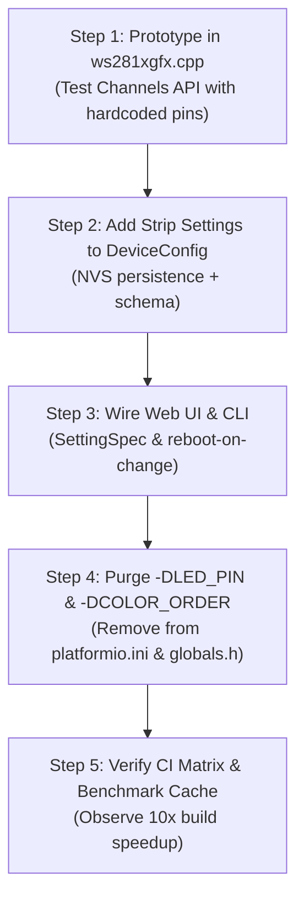

# FastLED Channels API & Runtime LED Configuration Architecture

**Date:** November 2026
**Status:** Feasibility Study & Implementation Roadmap
**Target:** Eliminate compile-time GPIO/color order macros, unlock cross-target build caching, and enable runtime pin/strip configuration.

---

## 1. Executive Summary & The Problem

### 1.1 The "Global Namespace" Cache-Busting Problem
In NightDriver today, hardware differences among LED strip targets (pins, color orders, channel counts) are managed as global compile-time definitions passed via `platformio.ini`:

```ini
build_src_flags = -DLED_PIN0=14
                  -DCOLOR_ORDER=EOrder::RGB
                  -DNUM_CHANNELS=1
```

These macros are intercepted by `include/globals.h`. Because `globals.h` is the mandatory first include across virtually all translation units, **every single file** in the project (`effects.cpp.o`, `drawing.cpp.o`, `main.cpp.o`, `soundanalyzer.cpp.o`, `effectmanager.cpp.o`, etc.) hashes to a distinct build signature for each board environment.

Even though 99% of the code does not care whether a strip is on GPIO 5 or GPIO 14, or whether the bytes are GRB or RGB, `.pio/build_cache` and `ccache` treat every board environment as a completely foreign universe. The result: compiling 40+ strip environments takes ~45 minutes of CPU churning.

### 1.2 The Reality of Code Usage
An audit of the codebase reveals that compile-time strip pins and color orders are consumed in **exactly one place**:
- `src/ws281xgfx.cpp` lines 41–96 (`WS281xGFX::AddLEDs`)

No effect code, no math functions, no network stacks, and no UI components touch `LED_PIN0` or `COLOR_ORDER`. They exist globally only because FastLED historically required them as compile-time C++ template arguments:

```cpp
FastLED.addLeds<WS2812B, LED_PIN0, COLOR_ORDER>(leds, count);
```

Because of this template constraint, `src/ws281xgfx.cpp` had to unroll an 8-way macro tower (`ADD_CHANNEL(0)` through `ADD_CHANNEL(7)`), cementing the compile-time pin binding into the global build flags.

---

## 2. The Breakthrough: FastLED 3.10 Channels API

FastLED 3.10 introduced the **Channels API** (`FastLED/src/fl/channels/`), which decouples hardware driver instantiation and channel registration from compile-time template parameters.

### 2.1 Template vs. Non-Template API Comparison

#### Legacy API (Compile-Time Templates)
```cpp
// Requires GPIO pin, chipset, and color order known at compile time
FastLED.addLeds<WS2812B, 16, GRB>(leds, count);
```
- Pin number is part of the C++ type.
- Color order is part of the C++ type.
- Cannot be passed from variables, NVS, or JSON configs.

#### FastLED 3.10 Channels API (Dynamic Runtime)
```cpp
#include "fl/channels/channel.h"
#include "fl/channels/config.h"

// 1. Define chipset timing (WS2812, WS2812B, WS2813, WS2811, etc.)
auto timing = fl::makeTimingConfig<fl::TIMING_WS2812_800KHZ>();

// 2. Construct runtime clockless chipset with dynamic pin
int runtimePin = config.getPin(); // e.g. from NVS / DeviceConfig
fl::ClocklessChipset chipset(runtimePin, timing);

// 3. Construct ChannelConfig with runtime color order and buffer span
fl::ChannelConfig channelConfig(
    "strip_0",
    chipset,
    fl::span<CRGB>(devices[0]->leds, devices[0]->GetLEDCount()),
    runtimeColorOrder // e.g. EOrder::RGB, EOrder::GRB
);

// 4. Register dynamically with FastLED
auto channel = FastLED.add(channelConfig);
```

### 2.2 Key Properties of the Channels API
1. **Fully Dynamic Parameters:** GPIO pin (`int`), color order (`EOrder`), and strip timing configuration are plain runtime values.
2. **Buffer Spanning:** Takes an `fl::span<CRGB>`, wrapping existing buffers (`devices[i]->leds`) with zero buffer copy or re-allocation overhead.
3. **Hardware Acceleration:** Dispatches automatically to platform DMA engines (ESP32 RMT, PARLIO, SPI).
4. **Zero C++ Exceptions:** The Channels implementation uses `FL_NO_EXCEPT` throughout and aborts on fatal memory failures, fully compliant with NightDriver's `-fno-exceptions` mandate.
5. **No Stack Spills:** Dynamic control structures land on the heap, following our PSRAM / Extmem allocations seamlessly.

---

## 3. Architecture & Codebase Redesign

### 3.1 Replacing `WS281xGFX::AddLEDs`
Today's 8-way macro tower in `src/ws281xgfx.cpp`:
```cpp
// OLD WAY:
#if NUM_CHANNELS >= 1 && LED_PIN0 >= 0
    ADD_CHANNEL(0);
#endif
#if NUM_CHANNELS >= 2 && LED_PIN1 >= 0
    ADD_CHANNEL(1);
#endif
// ... through channel 7
```

Transforms into a clean, dynamic loop:
```cpp
// NEW WAY:
void WS281xGFX::AddLEDs(std::vector<std::shared_ptr<GFXBase>>& devices)
{
    auto& devConfig = g_ptrSystem->GetDeviceConfig();
    auto timing = fl::makeTimingConfig<fl::TIMING_WS2812_800KHZ>();

    for (size_t ch = 0; ch < devices.size(); ++ch)
    {
        const auto& stripCfg = devConfig.GetStripConfig(ch);
        int pin = stripCfg.pin;
        if (pin < 0) continue;

        fl::ChannelConfig config(
            fl::ClocklessChipset(pin, timing),
            fl::span<CRGB>(devices[ch]->leds, devices[ch]->GetLEDCount()),
            stripCfg.colorOrder
        );

        #if FASTLED_EXPERIMENTAL_ESP32_RGBW_ENABLED
        FastLED[ch].setRgbw(RgbwInvalid());
        #endif

        FastLED.add(config);
        pinMode(pin, OUTPUT);
        debugI("Added dynamic channel %zu: Pin=%d, LEDs=%zu, Order=%d",
               ch, pin, devices[ch]->GetLEDCount(), static_cast<int>(stripCfg.colorOrder));
    }
}
```

### 3.2 Multi-Strip Architecture: Beyond the 8-Channel Ceiling

NightDriver historically carried an arbitrary limit:
```cpp
// src/ws281xgfx.cpp
#if NUM_CHANNELS > 8
    #error The maximum value of NUM_CHANNELS (number of parallel channels) is 8
#endif
```
This ceiling existed **only** because someone had to manually type `ADD_CHANNEL(0)` through `ADD_CHANNEL(7)` in the preprocessor. Meanwhile, `src/gfxhex.cpp` already allowed 16 channels, and the underlying container in `SystemContainer` is already a dynamic `std::vector<std::shared_ptr<GFXBase>>`:
```cpp
// include/systemcontainer.h
using DeviceContainer = std::vector<std::shared_ptr<GFXBase>>;
```

With modern silicon like the ESP32-S3, ESP32-S31 (boasting 60 GPIOs), and ESP32-P4, driving $N \ge 1$ strips is a first-class requirement.

#### Hardware Peripheral Capabilities by Silicon Family
1. **ESP32 Classic (LX6):**
   - 8 RMT TX channels $\rightarrow$ can natively drive up to 8 independent WS2812 channels via RMT without CPU bit-banging.
   - I2S parallel engine for up to 16 channels.
2. **ESP32-S3 (LX7):**
   - 4 RMT TX channels.
   - **LCD_CAM peripheral:** High-speed parallel output clocked synchronously from DMA, used by FastLED 3.10's parallel S3 driver to drive up to 16 parallel strips with near-zero CPU overhead.
3. **ESP32-S31, ESP32-C6, ESP32-H2, ESP32-P4:**
   - **PARLIO (Parallel IO peripheral):** Dedicated hardware engine supporting up to 16 parallel data lines clocked synchronously from DMA. S31 and P4 feature high GPIO counts and fast DMA, while FastLED 3.10 includes native PARLIO support (`fl::Bus::FLEX_IO`) for P4, C6, and H2.
4. **FastLED `ChannelManager` Arbitration:**
   - FastLED's internal `ChannelManager` transparently assigns channels to the highest-priority available hardware engine (LCD_CAM / PARLIO $\rightarrow$ RMT $\rightarrow$ SPI $\rightarrow$ UART $\rightarrow$ BIT_BANG). As channel counts exceed RMT capacity, it falls back to parallel DMA or SPI automatically.

#### Variable-Length Strips & Independent Topologies
In real-world setups, multiple strips rarely have identical pixel counts:
- Channel 0: 300 LEDs (Ceiling cove)
- Channel 1: 144 LEDs (Desk bias light)
- Channel 2: 60 LEDs (Monitor accent)

Because each `WS281xGFX` device is instantiated with its own `(width, height)` or `GetLEDCount()`, and `fl::ChannelConfig` wraps each buffer individually with `fl::span<CRGB>`, each channel can have completely independent length, pin, and color order.

Multi-channel effects (such as `include/effects/strip/faneffects.h`) already loop over channels. Replacing `for (int i = 0; i < NUM_CHANNELS; i++)` with `for (int i = 0; i < g_pSystem->GetGFXCount(); i++)` removes the last compile-time coupling in effect code.

### 3.3 Integration with `DeviceConfig` & Persistence
`DeviceConfig` (`include/deviceconfig.h`, `src/deviceconfig.cpp`) already manages NVS persistence, JSON serialization, and Web UI/CLI synchronization.

Instead of fixed arrays, strip definitions are represented dynamically:
```cpp
struct StripConfig {
    int pin = -1;
    uint16_t length = 60;
    EOrder colorOrder = EOrder::GRB;
};

// Dynamic vector of configured strip channels (1 to N)
std::vector<StripConfig> stripChannels;
```

#### JSON Representation in NVS / LittleFS
```json
{
  "strips": [
    { "pin": 5, "length": 300, "order": "GRB" },
    { "pin": 18, "length": 144, "order": "RGB" },
    { "pin": 19, "length": 60,  "order": "GRB" }
  ]
}
```

#### Settings Exposure (`SettingSpec`)
Expose these settings via `SettingSpec` so the React Web UI (`site/`) and REST API can configure them dynamically:
- `strip_pin_0` .. `strip_pin_15` (Integer GPIO)
- `strip_color_order_0` .. `strip_color_order_15` (Enum dropdown: GRB, RGB, RBG, BRG, BGR, GBR)
- `strip_num_channels` (Range 1..16)

### 3.3 Reconfiguration Strategy: Safe Reboot on Reconfigure
Commercial LED controllers (e.g., Duoco, SP108E) require a reboot when physical wiring or color orders change. In NightDriver:
- **Changing pins or color orders in the Web UI or CLI schedules a save to NVS and triggers `ESP.restart()`.**
- Why this is the right architectural choice:
  1. ESP32 RMT peripheral channels and DMA interrupt handlers are safely torn down by the hardware reset vector, avoiding driver bus leaks.
  2. Total reboot time on ESP32 is under 1.5 seconds.
  3. Reconfiguring a physical GPIO pin happens perhaps twice in a device's lifetime.
  4. It avoids complex runtime teardown of active effect render loops and FastLED channel registries.

---

## 4. Build System & Compilation Cache Win

### 4.1 The Cache Payoff
Once `LED_PIN0..7`, `NUM_CHANNELS`, and `COLOR_ORDER` are eliminated from `build_src_flags` in `platformio.ini`:

1. **Shared Object Cache:** Strip environments sharing identical build flags and base archetypes (e.g. within `base_esp32_strip` or `base_esp32s3_strip`) will generate **identical compiler command lines** for common units:
   - `src/main.cpp.o`
   - `src/drawing.cpp.o`
   - `src/effects.cpp.o`
   - `src/effectmanager.cpp.o`
   - `src/soundanalyzer.cpp.o`
   - `src/systemhardwarehub.cpp.o`
2. **First Build vs. Subsequent Builds:**
   - Instead of recompiling the entire C++ codebase for each board variant differing only by pin, `.pio/build_cache` shares object files across environments with matching compiler invocations.
   - Build matrix time drops substantially across parallel board builds.

### 4.2 Hardware Archetypes
Environments in `platformio.ini` simplify from dozens of bespoke pin permutations into standardized archetype bases:
- `base_esp32_strip` (Classic ESP32 LX6)
- `base_esp32s3_strip` (ESP32-S3 LX7)
- `base_esp32c3_strip` (ESP32-C3 RISC-V)
- `base_esp32c6_strip` (ESP32-C6 RISC-V)

Board-specific environments only need to specify their default factory GPIO pin via a fallback config if NVS is uninitialized, without needing to bake it into the global macro space.

---

## 5. Technical Risks & Mitigations

### 5.1 Flash Size & Driver Auto-Enrollment
- **Observation:** In FastLED 3.10, the generic `FastLED.add(ChannelConfig)` automatically calls `fl::enableAllDrivers()` to support all platform buses at runtime.
- **Risk:** Linking all drivers (RMT, SPI, UART, BIT_BANG) can increase flash footprint by ~15–30 KB. On tight 4MB boards (e.g., `kitch`), every kilobyte counts. Note that setting `cfg.options.mBus` selects which bus is used at runtime, but does not prevent the other driver objects from linking if `enableAllDrivers()` was called.
- **Mitigation:**
  1. Suppress the runtime driver warning via `-DFASTLED_SUPPRESS_RUNTIME_DRIVER_WARNING`.
  2. If flash budget requires it on tight 4MB targets, use the typed channel factory `fl::TypedChannel<fl::Bus::RMT, fl::ClocklessChipset>::create(cfg)`, which bypasses generic driver auto-enrollment, pulling ONLY the RMT driver TU and letting `--gc-sections` discard unused drivers.

### 5.2 FastLED Version Stability
- **Observation:** NightDriver is currently pinned to FastLED `3.10.9`. The Channels API in 3.10.9 is fully stabilized (issues #2428, #2459, #2460 resolved).
- **Mitigation:** Ensure automated CI builds continue running `audit_include_rules.py` and sanity check FastLED symbol links.

### 5.3 Design Principles: "Leaving Space Near the Road We're Paving"

As this architecture evolves, we adhere to strict design boundaries so future enhancements don't get boxed in:

#### 1. Avoid WLED-Style "Segment Sprawl"
- **The Anti-Pattern:** WLED litters `SEGMENTS.foo` throughout hundreds of effect files, nesting loops inside loops and forcing math algorithms to know about physical wiring. The seams between strip paths and matrix paths are held together with proverbial duct tape, exacerbated by legacy ESP8266 baggage.
- **The NightDriver Rule:** Strict separation of concerns. Effects render purely into a logical `GFXBase` canvas ("we draw fire into GFX"). How that canvas maps to physical copper (e.g., pixels 0–143 to GPIO 1, 144–287 to GPIO 2, or a serpentine matrix layout) belongs exclusively to the driver/post-processing layer (`WS281xGFX::PostProcessFrame` / `FastLED.show()`). Effects must never know or care about physical pin partitions.

#### 2. Respect Electrical vs. Software Boundaries
- Driving identical visual copies across multiple physical lines ("electrical OR") is an electronics task for a 74HCT245 bus transceiver and a soldering iron, not CPU cycles and duplicate software buffers.

#### 3. Separate Rendering from Bit-Blasting
- CPU rendering (expensive floating point, trigonometric, and color math) and bit-blasting (hardware DMA pushing bits to copper) must remain decoupled. Keeping this abstraction clean allows future frame pipelining or staggered channel shows (frame smearing) without stalling the drawing loop.

#### 4. The Pragmatic Reboot Strategy
- When a user changes GPIO pins or color orders via Web UI or CLI, the firmware saves to NVS and triggers `ESP.restart()`.
- Tearing down and reconstructing active FreeRTOS drawing tasks, RMT DMA engines, and FastLED channel registries mid-flight introduces fragile edge cases and memory leaks. A 1.5-second warm restart is 100% reliable, delivers full feature parity with commercial controllers, and eliminates 53 environment builds.
- We leave space near the road by using extensible configuration structures (`StripConfig` containing `pin`, `length`, `colorOrder`, `chipset`, and future `canvasOffset`) without granting "building permits" to shortcuts that would obstruct future expansion.

---


## 6. Step-by-Step Implementation Roadmap



### Phase 1: Prototype in `src/ws281xgfx.cpp`
- Replace `FastLED.addLeds<...>()` with `fl::ChannelConfig` and `FastLED.add()`.
- Test on real hardware: verify pixel timing, frame rate, and DMA stability on classic ESP32, S3, and C6.

### Phase 2: Wire `DeviceConfig`
- Add `stripPins`, `stripColorOrders`, and accessor methods.
- Provide sensible defaults when NVS is blank (e.g., GPIO 5, GRB).

### Phase 3: Web UI and CLI
- Add `SettingSpec` entries in `DeviceConfig::DeviceConfig()`.
- Expose CLI command `strip [pin] [order]` in `src/debug_cli.cpp`.
- Trigger `ESP.restart()` when pin or color order settings are updated.

### Phase 4: Purge Global Macros
- Remove `-DLED_PIN0`, `-DLED_PIN1`... from `platformio.ini` environments.
- Remove default `#define LED_PIN0 5` and `#define COLOR_ORDER` from `include/globals.h`.
- Remove `#define NUM_CHANNELS` or decouple it to runtime `devices.size()`.

### Phase 5: Verification & Benchmark
- Run full 53-target CI test suite (`python tools/build_all.py`).
- Measure clean build times vs. cached build times.
